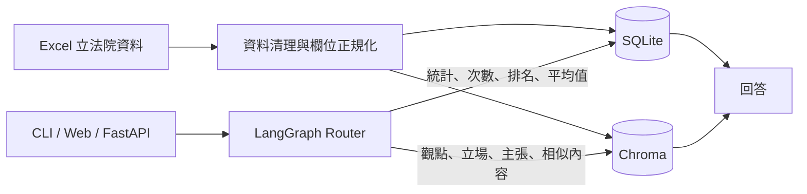

# PocketCongressRAG

PocketCongressRAG 是以台灣立法院發言資料為基礎的 Hybrid RAG 應用，結合 SQLite 結構化查詢與 Chroma 向量檢索，並透過 LangGraph 選擇回答路徑，部署於 GCP Cloud Run。

## 操作展示

[PocketCongressRAG Demo 影片](https://drive.google.com/file/d/1f1q89tF8u176NgezlKZk2JxG94U01AGf/view?usp=sharing)

影片展示開啟網頁、選擇會期，以及分別執行 SQL 與 Vector 問題的操作流程。

問答輸入與系統回答可參考 [QA 範例](docs/examples/QA_example.xlsx)。

## 核心功能

- Hybrid RAG：統計、次數、排名與平均值等需要計算的問題使用 SQLite；觀點、立場、主張與相似內容搜尋使用 Chroma。
- 條件式檢索：可依會期、立法委員、涵蓋層級及委員會縮小查詢範圍。
- 多介面使用：提供互動式 CLI、FastAPI endpoints 與瀏覽器問答頁面。
- 多模型供應商：Chat 與 Embedding 可分別選擇 OpenAI 或 Vertex AI。
- 開發與部署：使用 Poetry、Docker Compose 與 Cloud Run deployment bundle。

## 系統流程



## Tech Stack

| 類別 | 技術 |
|---|---|
| Language | Python 3.12 |
| Workflow | LangGraph、LangChain |
| API / Web | FastAPI、Uvicorn、HTML、CSS、JavaScript |
| Structured Search | SQLite |
| Vector Search | Chroma |
| Data Processing | pandas、openpyxl |
| AI Providers | OpenAI、Vertex AI |
| Environment | Poetry、Docker Compose |
| Deployment | Cloud Build、Cloud Run |

## 快速開始

### 1. 安裝環境

先安裝 [Python 3.12](https://www.python.org/downloads/) 與 [Poetry 2.2.1](https://python-poetry.org/docs/#installation)，並確認版本：

```bash
python3.12 --version
poetry --version
```

下載專案並安裝依賴：

```bash
git clone https://github.com/SandyCCT/PocketCongressRAG.git
cd PocketCongressRAG
poetry env use python3.12
poetry install
```

### 2. 設定環境變數

```bash
# macOS / Linux
cp .env.example .env

# Windows PowerShell
copy .env.example .env
```

使用 OpenAI 時，至少設定：

```ini
CHAT_PROVIDER=openai
EMBEDDING_PROVIDER=openai
OPENAI_API_KEY=your_api_key_here
DATA_FOLDER_PATH=../data/sessions
INDEX_REBUILD_POLICY=auto
```

Vertex AI、索引路徑與 `INDEX_REBUILD_POLICY` 請參考[環境設定說明](docs/configuration.md)。

### 3. 準備資料

將會期 Excel 放入 `data/sessions/`：

```text
data/sessions/第H屆第N會期 (YYYYMM ~ YYYYMM).xlsx
```

Excel 必要欄位與多值欄位規則請參考[資料欄位規格](docs/data-contract.md)。

### 4. 執行 CLI

```bash
cd src
poetry run python run_workflow.py
```

第一次選擇各會期時，`auto` 會建立對應的 SQLite 與 Chroma index；後續會沿用相容的 index。若只要驗證既有 index，可將 `.env` 改為：

```ini
INDEX_REBUILD_POLICY=verify_only
```

`verify_only` 遇到未建立或不相容的 index 時會停止。Cloud Run 固定使用此設定。

## FastAPI 與網頁

在 `src/` 目錄啟動：

```bash
poetry run uvicorn api:app --host 127.0.0.1 --port 8000
```

- 問答頁面：<http://127.0.0.1:8000/>
- OpenAPI 文件：<http://127.0.0.1:8000/docs>

主要 endpoints：

| Method | Endpoint | 用途 |
|---|---|---|
| `GET` | `/health/live` | 確認 FastAPI 程序可回應 |
| `GET` | `/health/ready` | 唯讀驗證資料庫與 index 是否可用 |
| `GET` | `/api/v1/sessions` | 取得可查詢的會期 |
| `POST` | `/api/v1/questions` | 執行單次問答 |

```bash
curl -X POST http://127.0.0.1:8000/api/v1/questions \
  -H 'Content-Type: application/json' \
  -d '{"session_id":"S_11_1","question":"總共發言幾次？","member_name":"王育敏"}'
```

## Docker Compose

於專案根目錄 `PocketCongressRAG/`（包含 `compose.yaml` 與 `Dockerfile` 的目錄）執行：

```bash
mkdir -p instance
docker compose up -d --build
docker compose ps
```

Compose 使用主機的 `data/sessions/` 與 `instance/`，服務發布在 `127.0.0.1:18000`。

先確認服務與會期資料：

```bash
curl http://127.0.0.1:18000/health/live
curl http://127.0.0.1:18000/api/v1/sessions
```

第一次提問會建立該會期的 index：

```bash
curl -X POST http://127.0.0.1:18000/api/v1/questions \
  -H 'Content-Type: application/json' \
  -d '{"session_id":"S_11_1","question":"總共發言幾次？","member_name":"王育敏"}'
```

完成後檢查 readiness：

```bash
curl http://127.0.0.1:18000/health/ready
```

Vertex AI 的 ADC 掛載與 provider 設定請參考[環境設定說明](docs/configuration.md)。

## 驗證

執行離線測試：

```bash
cd src
PYTHONDONTWRITEBYTECODE=1 poetry run python -m unittest discover -s ../tests -q
```

在專案根目錄檢查 Poetry 設定：

```bash
poetry check
```

## Cloud Run 部署

完整流程請參考 [Cloud Run 部署指南](docs/cloud-run-deployment.md)。

## 文件

- [資料欄位規格](docs/data-contract.md)
- [環境設定與索引行為](docs/configuration.md)
- [Cloud Run 部署指南](docs/cloud-run-deployment.md)
- [完整專案結構](docs/project-structure.md)
